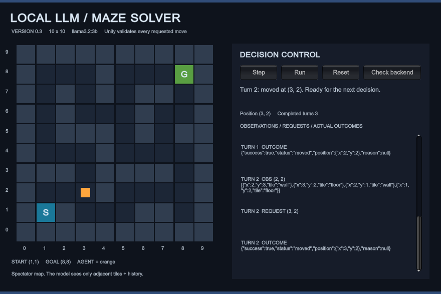

# Version 0.3 navigation fix - 2026-10-27

## Problem and acceptance

The user observed repeated wall attempts from `(1,1)`, followed by an invalid
model reply. The earlier live test accepted an acknowledged blocked turn; it
proved connectivity and collision handling but did not prove useful movement.

Acceptance for this fix: the real model must move the agent away from the start
across multiple Unity turns. Invalid replies must still stop the session, and
neither a hidden map, a route, nor a program-selected move may reach the model.

## Changes

- The prompt explicitly identifies the walkable neighboring coordinates from
  Unity's current observations. It includes factual visit counts and explains
  blocked outcomes and backtracking. Neighbors are not ranked or selected by code.
- Known-tile memory contains only tiles previously observed by Unity. The prompt
  includes the last eight completed turns, while retaining all observed tile
  knowledge and actual-entry counts. Full observations, raw replies, and outcomes
  remain in backend session history and logs.
- Ollama receives a per-turn JSON schema offering every in-bounds orthogonally
  adjacent coordinate, including walls. It selects a coordinate itself. The
  schema prevents diagonal/jump syntax without ranking destinations, checking a
  hidden map, or substituting a move. Backend and Unity validation remain active.
- The move schema lists `action` before `x` and `y`. Public JSON fields and
  endpoint shapes are unchanged.
- The opt-in Unity test is now `RealBackendAndModelMakeProgress`: it requires
  three completed real model turns and at least three distinct visited tiles.
  An HTTP 200 or blocked attempt alone cannot pass it. Screenshot verification
  also checks that the image was written during the current test run.
- Added backend tests for geometry constraints, transport forwarding, visit
  counts, old explored knowledge, and removal of raw-response prompt noise.

## Checks actually run

| Check | Result |
| --- | --- |
| Original prompt, local model + maze authority fixture | Six repeated wall requests, then an invalid reply; zero movement |
| Updated backend tests | 39 passed; one existing Starlette/HTTPX deprecation warning |
| Updated Unity PlayMode suite | 10 passed, 0 failed, 0 skipped |
| Real Unity turn 0 | `(1,1)` to `(1,2)`, `moved`, outcome acknowledged |
| Real Unity turn 1 | `(1,2)` to `(2,2)`, `moved`, outcome acknowledged |
| Real Unity turn 2 | `(2,2)` to `(3,2)`, `moved`, outcome acknowledged |
| Fresh screenshot | Captured and visually inspected with agent at `(3,2)` |
| Longer updated model + maze authority fixture | 50 turns: 36 moves, 14 blocked attempts, zero invalid-output errors; goal not reached |

The two fixture runs used actual Ollama outputs and a test authority loaded from
the fixed Unity map. Their outcomes were simulated by that fixture, not claimed
as Unity results. The three live turns separately used the actual wired Unity
scene and real backend/Ollama. No move was chosen by the fixture or test code.

Backend command: `python -m pytest backend/tests -q` in the root virtual
environment. Unity used installed **6000.3.26f1**, an isolated project copy, and
the PlayMode test runner with `MAZE_LIVE_TEST=1`. A fresh test backend ran on
port 8001, selected through the test-only `MAZE_BACKEND_URL` environment variable,
so an existing user server on port 8000 was not disturbed. The shipped game
still defaults to port 8000. Temporary test processes were stopped afterward.



## Apply the fix to an already running demo

1. In the Python server terminal, press **Ctrl+C**. A server started without
   `--reload` continues using its old imported code until restarted.
2. From the repository root, run:

   ```powershell
   .\.venv\Scripts\python.exe -m uvicorn backend.app.main:app --host 127.0.0.1 --port 8000
   ```

3. In the Unity Game view, press **Reset**, then **Step** or **Run**. A new
   session is required after a server restart. No Inspector rewiring is needed.

## Limits

This demonstrates movement beyond the start, not reliable maze solving. The
longer run still looped and tried walls. Real model goal completion remains
unverified. There is no automatic retry, pathfinding fallback, or hidden-map
prompt. Invalid model replies remain visible errors. The original standalone
Windows build and team-review limitations still apply.
