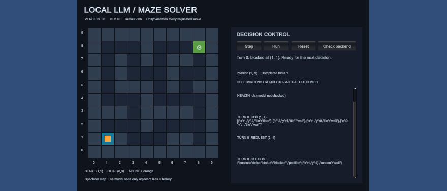

# Version 0.3 Unity verification - 2026-10-27

## Target and acceptance

This milestone implements a fixed 10 x 10 walls-only maze, fixed start `(1,1)`
and goal `(8,8)`, visible agent and logs, reset, goal detection, and a real
Unity/Python/Ollama turn. Unity validates every destination. The game has no
pathfinder, scripted navigation, or fallback move selector.

Acceptance: compile in Unity 6000.3.26f1; pass movement/protocol and controller
tests; execute and report a real model decision from the actual wired scene;
and inspect a rendered screenshot.

## Changes

- Added separate maze rules, JSON protocol, HTTP transport, and game controller
  under `unity/Assets/Scripts/`, with assembly definitions and all `.meta` files.
- Wired the game controller into the existing `SampleScene`.
- Added runtime maze rendering and Step, Run, Pause, Reset, and Check backend
  controls, with visible status and a scrollable observation/decision/outcome log.
- Added isolated EditMode and PlayMode test assemblies under `Assets/Tests/`.
- Added Unity's official Newtonsoft JSON package 3.2.2 and its resolved lock entry.
- Enabled **Both** input systems for runtime IMGUI input, and allowed plain HTTP
  for the local backend. These are the only PlayerSettings changes.
- Added demo instructions, this verification record, and a real rendered PNG.
- Ignored `.verification/`, which holds a separate test project and generated
  logs/results, so testing does not disturb the user's open project or commit
  Unity caches.

## Results actually obtained

| Check | Actual result |
| --- | --- |
| Unity version | Installed Unity 6000.3.26f1 |
| EditMode tests | 17 passed, 0 failed |
| PlayMode tests (rendered editor run) | 10 passed, 0 failed, 0 skipped |
| Backend regression tests | 33 passed; one installed Starlette/HTTPX deprecation warning |
| Real Unity health request | HTTP 200, status ok |
| Real Unity decision request | HTTP 200; Ollama selected `(2,1)` from `(1,1)` |
| Unity's actual resolution | Wall rejected; position remained `(1,1)` |
| Real Unity outcome report | HTTP 200 acknowledgement from Python |
| Rendered screenshot | Captured from the actual SampleScene and visually inspected |
| Asset metadata | Every asset/folder has a `.meta` file |
| Diff whitespace check | `git diff --check` passed |

The live request used `llama3.2:3b`, not a fake model. The requested wall move was
preserved and resolved as blocked. It was not changed into a successful move.
Backend logs contain the raw model response and actual blocked outcome.

The other controller tests use explicit fake HTTP responses to verify legal
movement, blocked movement, malformed responses, outcome-report failures,
illegal destinations, pause, reset with a late response, duplicate-step
prevention, and goal acknowledgement before stopping. The map/goal tests use
test-only movement inputs; those inputs are not in the game assembly or model
prompt. Goal completion was tested this way, not by claiming the live model
finished the maze.



## How verification was run

Copied only `Assets/`, `Packages/`, and `ProjectSettings/` into
`.verification/unity/`. The editor imported and compiled this isolated project.
EditMode was run with the installed editor's command-line test runner:

```text
Unity.exe -batchmode -nographics -projectPath <isolated-project>
  -runTests -testPlatform EditMode -testResults <editmode-results.xml>
  -logFile <editmode.log>
```

Started the real backend from the repository root:

```powershell
.\.venv\Scripts\python.exe -m uvicorn backend.app.main:app --host 127.0.0.1 --port 8000
```

Then launched the isolated editor with `MAZE_LIVE_TEST=1` and
`MAZE_SCREENSHOT=<absolute-PNG-path>` in its environment, with `-runTests
-testPlatform PlayMode -testResults <playmode-rendered-results.xml> -logFile
<playmode-rendered.log>`. This final run used a normal editor process launched
hidden, with rendering enabled. All ten tests, including screenshot capture,
passed. The temporary editor and backend were stopped after verification.

Initial checks exposed a missing JSON test-assembly reference, which was fixed.
The first batch-mode PlayMode run completed the real turn but failed its
screenshot assertion because no image was produced. That was a failed run;
the final rendered-editor run above is the passing result.

## Limitations and remaining work

- No standalone Windows executable was built or tested in this milestone.
- Tests invoke the control methods; they do not automate mouse clicks. Follow
  `unity-demo.md` to check the buttons manually in your editor's Game tab.
- No claim that the real model can solve this maze. Repeated walls, loops, and
  visible model errors remain possible and acceptable for Version 0.3.
- Backend history is process-local and unpruned. Restarting/reloading Python
  requires a new run. The visible Unity log keeps the last 200 entries.
- Protocol team review and teammate-machine demonstration remain outstanding.
- Version 0.5/1.0 features are not implemented.

Next user action: start the backend, open SampleScene, press Play, and click
Check backend followed by Step. See [the demo guide](unity-demo.md).
